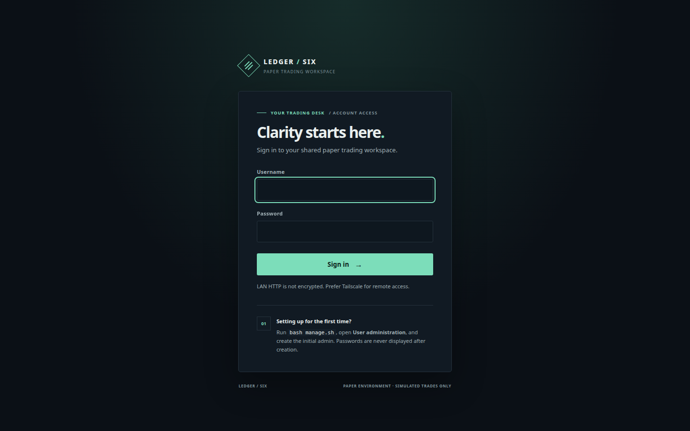
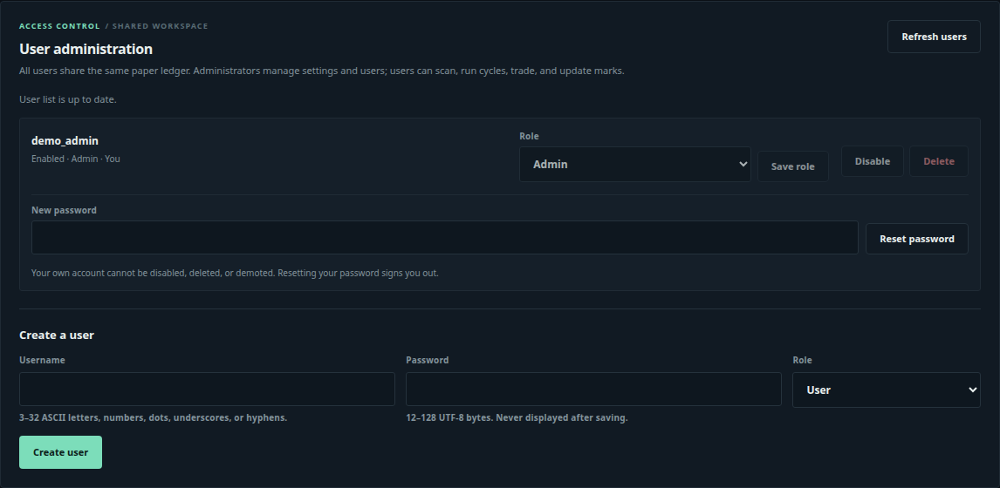
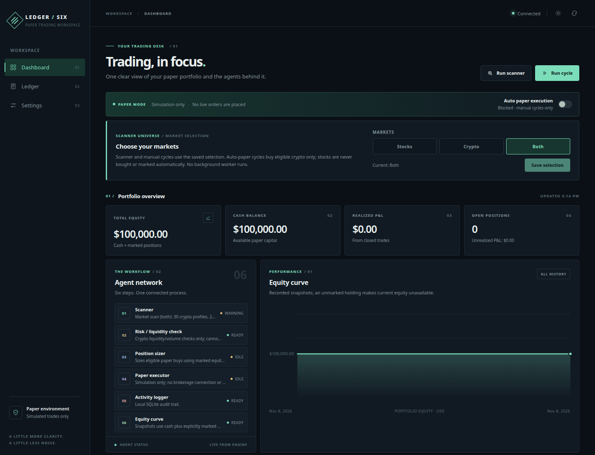
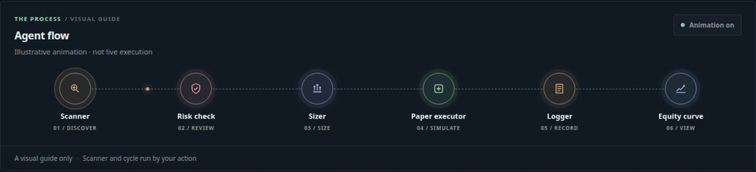
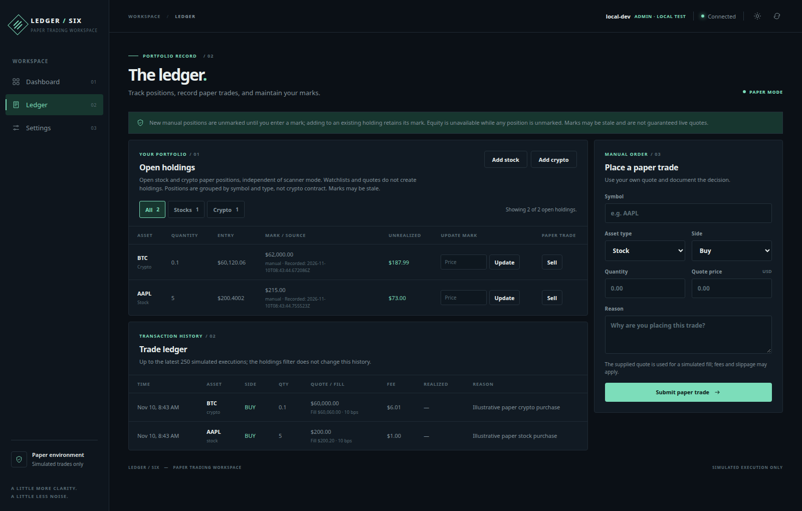
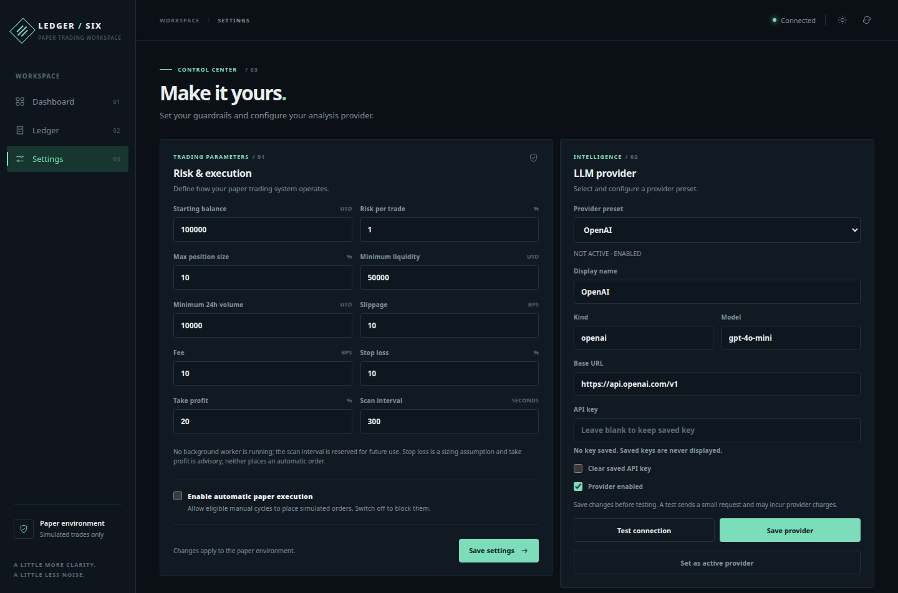
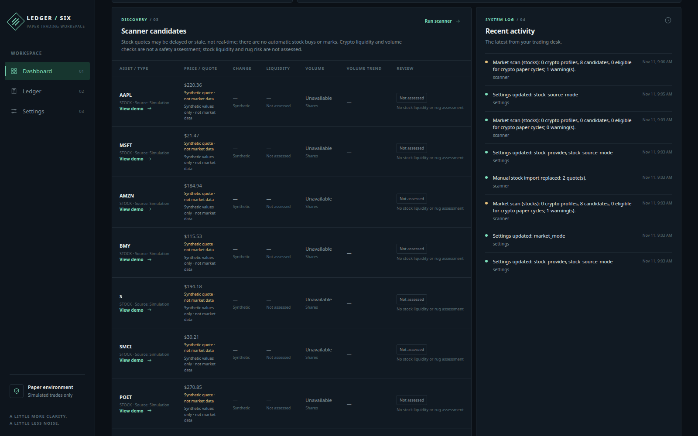
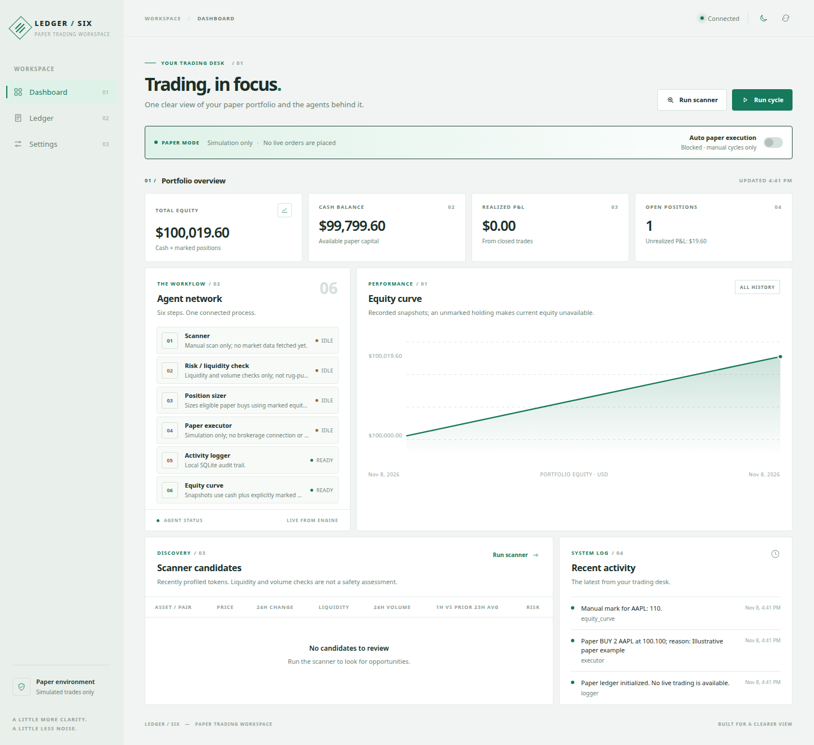
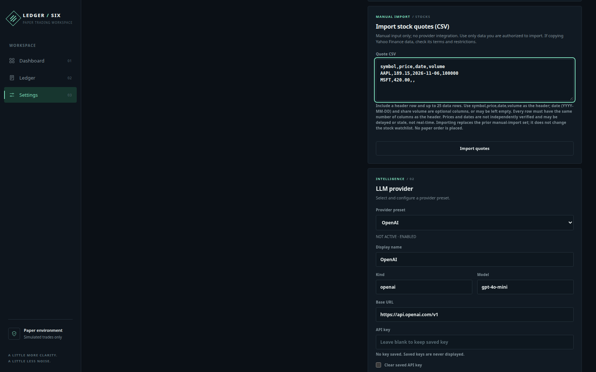

# PaperLedger / Ledger Six

A self-hosted dashboard for stock and cryptocurrency paper trading, with a persistent ledger, market scanner, configurable AI providers, and an interactive Docker administration script.

**Personal project disclaimer:** This software is for educational and personal use only. It is not investment, financial, tax, or legal advice. Trading involves substantial risk, including loss of all capital. There is no guarantee of profits, data accuracy, or future performance. Use at your own risk.

**Lalit Nayyar**

Email: [lalitnayyar@gmail.com](mailto:lalitnayyar@gmail.com)

Phone: [+971 50 832 0336](tel:+971508320336) / [+91 95953 53336](tel:+919595353336)

## Screenshots

These screenshots were captured from the application in a sandbox. The example balances and stock trades are illustrative simulated data, not a real account or performance record. The scanner screenshot is a time-specific external market-data snapshot; its prices may be stale and it is not an endorsement or safety assessment.

### Sign in



### User administration



### Dashboard and workflow



### Animated agent flow



The agent-flow panel is an illustrative visual guide, not an indication of active trading or live agent execution. Use its **Animation** button to pause or resume the decoration. It automatically respects your system's reduced-motion setting; pausing it does not start or stop the scanner or paper cycle. The separate agent network shows the engine's reported status.

### Stock and crypto ledger



### Risk and stock scanner settings



### Stocks and crypto scanner



### Light theme



## Important boundaries

- **Paper trading only.** There is no broker or exchange connection, no wallet signing, and no real-money execution. Never enter wallet seeds, exchange withdrawal credentials, or broker credentials here.
- Values and fills in this application are simulations. They are not evidence of live execution, executable prices, exchange liquidity, realistic gas, taxes, market impact, or achievable returns.
- The token scanner uses public DEX Screener market information. A recently published token profile is not necessarily a newly created token or pair. Public data can be delayed, incomplete, manipulated, rate-limited, or unavailable.
- The liquidity and volume checks are **basic filters, not a smart-contract security audit**. They cannot detect every honeypot, malicious contract, token tax, or rug pull. A token passing the filters is not certified safe.
- The stock scanner uses Alpha Vantage end-of-day quotes for a configurable watchlist of US-listed, USD-priced stocks. Quotes can be delayed or stale, do not verify liquidity or safety, and are not automatically used as position marks. Stock paper trades remain manual; there is no brokerage synchronization.
- There is **no continuous trading worker**. The scanner and paper cycle run only when you click their buttons. Enabling automatic paper execution allows a manually triggered cycle to simulate up to three eligible **crypto** buys; stocks are not automatically bought. It does not schedule cycles. The scan-interval field is reserved for a future version. Stop-loss is only a sizing assumption and take-profit is advisory: neither automatically closes positions.
- Manual buys have no mark until you enter one. Total equity and unrealized P&L are unavailable while any holding is unmarked; older chart points may still appear. Even a recorded mark can be stale. For crypto, symbols are not unique across chains and contracts; this simple ledger groups positions by symbol and asset type, so do not combine distinct tokens that share the same symbol.
- AI provider responses are advisory and may be wrong. The six stages are programmatic workflow stages; they are not six independent autonomous LLMs. LLM responses cannot place live trades.
- The app supports multiple authenticated users in **one shared workspace**. All users can see the same ledger; accounts are not separate portfolios or isolated tenants. It binds to `127.0.0.1` by default. Opt-in network access publishes on every IPv4 interface, which may include public interfaces. The built-in HTTP listener does **not** provide TLS: on a LAN, passwords and app data travel in cleartext. Tailscale encrypts traffic between authenticated tailnet devices, but access still depends on tailnet policy, the host firewall, and app login. Use only trusted networks, verify the effective firewall rules, and never forward the port to the public internet. This project is not an independently audited internet-facing service. Custom provider URLs can reach network destinations available to the container, so configure trusted endpoints only.

## Requirements

- Docker Engine or Docker Desktop with Docker Compose v2.
- Internet access for image builds, stock and token scanners, and cloud model calls. A local Ollama model can run without an internet connection once installed.
- A computer that stays powered on while you use the app. Stopping the container stops background tasks. Persistent data is kept in a Docker volume.

## Start with Docker

Clone this repository and open the interactive administrator:

```bash
git clone https://github.com/lalitnayyar/paperledger.git
cd paperledger
bash manage.sh
```

Choose **Install / build / start**. The manager offers the configured port, a manually chosen port, or an automatically selected available port, then displays the local URL reported by Docker. After the container starts, open **User administration** in the manager and create the first administrator. There is no default username or password; until an administrator is created, the app remains locked. Automatic port selection requires Python 3 on the machine running the script. Without Python 3, manual and configured ports are unverified until Docker binds them. On Windows, use WSL with Docker Desktop integration or Git Bash with Docker Desktop running. The probe checks the local environment, which can differ from the Docker host; a port can also become occupied between probing and startup. If Docker reports a conflict, choose another port and retry.

Alternatively, extract `ledger-six-docker.zip`, open the extracted `tradeledger` folder, and run `bash manage.sh`. The archive is not a Git checkout, so clone the repository if you want to use the manager's Git update option.

For a direct non-interactive deployment with the default port:

1. Open a terminal **inside the repository folder containing `compose.yaml`**.
2. Copy the example environment file:

   ```bash
   cp .env.example .env
   ```

   Windows PowerShell:

   ```powershell
   Copy-Item .env.example .env
   ```

3. Start the container:

   ```bash
   docker compose up -d --build
   ```

4. Run `bash manage.sh` and use **User administration** to create an administrator. Your chosen password is not stored in plaintext. There are no default credentials.
5. Open **http://127.0.0.1:8080** on the same computer and log in. Change `APP_PORT` in `.env` before starting if 8080 is occupied.
6. Start in paper mode. Set a starting balance and risk parameters, choose **Stocks**, **Crypto**, or **Both** on the dashboard, and run the scanner. A paper balance is not real money.

Useful commands:

```bash
docker compose ps
docker compose logs -f ledger
docker compose restart
docker compose down              # Stops/removes the container, but preserves data.
```

Linux/macOS and Git Bash users can also run `./deploy.sh`. To pull the latest code from GitHub and rebuild an **existing Git checkout with a configured upstream**, run `./deploy.sh --update`. It displays the current version and the version after the pull, requires a clean tracked working tree, uses `git pull --ff-only`, and preserves the data volume. An extracted ZIP is not a Git checkout; clone the repository first to use this option.

### Interactive administration

Run the administrative menu from the project directory:

```bash
bash manage.sh
```

On Windows, use WSL with Docker Desktop integration or Git Bash with Docker Desktop running. The menu can install and rebuild, pull from an existing Git checkout, show the current version and health, start/stop/restart the service, view and export logs, choose or find an available local port, back up or restore data, and remove the application. Option **9** changes the port; apply it by choosing install/build/start. Option **14** exports all Compose-project container logs into one private file under `backups/log-exports/` and prints its path. Option **15** selects network access, and option **16** manages users. Clean removal preserves data; the separate full-deletion option requires typing `DELETE DATA`. Both preserve `.env` and the `backups/` directory. Exported logs may contain sensitive information; review them before sharing.

The menu's backups are stored under `backups/` with restricted permissions where the filesystem supports them. They can contain private ledger data, account password hashes, and the generated encryption key. Restore accepts **trusted archives only**, requires typing `RESTORE DATA`, and creates a backup of the existing volume before replacing it. A failed restore keeps the application stopped and reports the pre-restore backup location. The menu does not include `.env` or externally supplied encryption keys in its archive; back them up separately. Do not run concurrent administration or other writers against the volume. Backups use an `alpine:3.20` helper image, which Docker may need to download.

### Login and user administration

An administrator can create and manage accounts from **Settings → User administration**. In the management script, choose option **16 → 2**, enter a username, choose the `admin` role for the first administrator, and enter and confirm a strong password. The same menu supports password resets and recovery. Passwords must be 12–128 UTF-8 bytes; the app stores salted password hashes, not plaintext passwords. Anyone with access to the host and Docker administration can administer accounts, so protect that access.

Administrators can manage users and change application and provider settings. Standard users can view the shared dashboard and ledger, run scans and paper cycles, and create or mark paper trades; they cannot change global settings, provider credentials, or users. All accounts share the same paper portfolio and activity. Disabling an account or resetting its password invalidates its sessions. The final enabled administrator cannot be removed or disabled.

### Localhost, LAN IP, and Tailscale IP

1. Start the app in its default localhost-only mode and create an administrator using **User administration** (option **16**) in `bash manage.sh`.
2. In the manager's **Network access** option (**15**), select access on all IPv4 interfaces (**2**). Read the warning and type `ENABLE NETWORK` to confirm. When offered, type `YES` to apply the setting now so Docker rebuilds and recreates the service. The named data volume is preserved. The manager does not install Tailscale or change firewall settings.
3. On the Docker or forwarding host, find its LAN IPv4 address in your operating system's network settings. If Tailscale is installed on that host, `tailscale ip -4` shows its Tailscale IPv4 address. The manager's port display is the source for the port number.
4. Open `http://127.0.0.1:PORT` on the host, `http://LAN-IP:PORT` from an allowed LAN device, or `http://TAILSCALE-IP:PORT` from an allowed device on the same tailnet. Replace the placeholders with the actual address and port, and sign in. Tailscale access requires Tailscale to be connected and policy to permit traffic on both devices.

`0.0.0.0` is a wildcard bind address, not a browser address. It exposes the port on **all reachable IPv4 interfaces**, not just Tailscale; it may include public-facing interfaces. Restrict access using the effective Docker/host firewall and tailnet policies, do not enable router port forwarding, and verify access from the intended and unintended networks. Docker can bypass conventional Linux UFW rules. On Docker Desktop, Windows/WSL, or a remote daemon, the host's addresses and forwarding behavior can differ from those of the shell running the manager. These addresses and peer connectivity are not automatically verified.

**LAN HTTP is unencrypted:** anyone able to observe the traffic can potentially see passwords, session cookies, ledger data, and settings. Prefer Tailscale between devices, and use LAN HTTP only on a trusted network. Tailscale encrypts the connection between its devices, but does not prevent an authorized peer from using the app. Switching back to localhost-only in the manager requires rebuilding/recreating the service to take effect; account data is retained.

#### Troubleshooting: the app only opens on localhost

Run `docker compose ps` in the project directory. A mapping such as `127.0.0.1:52533->8000/tcp` means the running container is published **only on localhost**, even if the service is healthy. A simple container restart does not apply an updated Compose port mapping; the container must be recreated.

On a Git checkout, pull the latest update and start the network-repair helper:

```bash
git pull --ff-only
bash fix-network.sh
```

The helper opens the manager and explains the steps; it does not change the bind address without your confirmation. If the installed image is older and the manager cannot detect an administrator, first choose **1** to build/start the updated localhost service, use **16** to create an administrator if needed, then choose **15 → 2**, type `ENABLE NETWORK`, and type `YES` to apply. The manager verifies the Docker-reported address and port. It will warn if the running port differs from the configured port rather than silently changing it. An optional `bash fix-network.sh --update` pulls the configured Git upstream before opening the manager; it requires a clean tracked working tree. Neither path deletes the data volume.

Afterward, `docker compose ps` should show `0.0.0.0:PORT->8000/tcp` for the IPv4 mapping. Use `http://LAN-IP:PORT` or `http://TAILSCALE-IP:PORT` in the browser—not `0.0.0.0`. If the wildcard mapping is present but another device still cannot connect, check that the IP belongs to the actual Docker/forwarding host, the device is on the intended LAN or tailnet, and the effective firewall and Tailscale policies allow the connection. A wildcard mapping alone does not prove remote reachability. Do not post `.env` or API keys when requesting help.

### Stocks, crypto, or both

Use the market selector on the dashboard to choose **Stocks**, **Crypto**, or **Both**, select **Save selection**, then select **Run scanner**. The choice is saved. Crypto uses recently profiled DEX Screener tokens; its liquidity and volume checks are not a contract audit. Stock results come from a configurable list of US-listed, USD-priced symbols using Alpha Vantage's `GLOBAL_QUOTE` endpoint. A stock result includes its latest trading day and trading volume in shares, not token liquidity or 24-hour dollar volume.

The default stock watchlist contains `IBM`, which can be tested with the provider's public demo key. To scan your own symbols, obtain an [Alpha Vantage API key](https://www.alphavantage.co/support/#api-key), add it in **Settings**, and edit the stock watchlist (up to 25 symbols). The service is rate-limited: each uncached symbol can use one API request, and Alpha Vantage currently documents 25 requests per day on its standard free tier for most datasets; check the provider for current limits and terms. If one source is unavailable in **Both** mode, review any warnings and the observation dates rather than assuming both scans succeeded.

To reduce repeat calls, the app caches successful stock quotes for six hours and keeps older cached quotes if a later request fails. Cached results are labeled with their original fetch time and trading day. The cache cannot bypass an exhausted quota or a provider outage. If the provider reports a limit, wait for the provider's limit to reset before manually scanning again, or reduce the watchlist; the app does not retry in the background. A saved key does not prove that a provider accepted every request.

### Manually import Yahoo Finance quotes

In **Settings → Import Yahoo Finance quotes**, paste up to 25 stock quotes that you are authorized to use. The app does not automatically connect to Yahoo Finance: [Yahoo's terms](https://legal.yahoo.com/us/en/yahoo/terms/otos/index.html) restrict automated data collection without its prior express permission. Yahoo says its [market data](https://help.yahoo.com/kb/SLN2310.html) is informational, not intended for trading or investing, and must not be redistributed. Check the applicable terms before importing any data.



Use a CSV header and one row per stock. These example prices are illustrative, not market quotes:

```csv
symbol,price,date,volume
AAPL,189.15,2026-11-06,100000
MSFT,420.00,,
```

Date and volume are optional. User-imported quotes are not independently verified and can be stale; the import time is not the quote time. Verify the price and any supplied date before using a quote. Imported quotes are displayed alongside scanner results in Stocks or Both mode, persist across scans and restarts, and never trigger stock buys or automatic marks. A new successful import replaces the previous imported set.

Alpha Vantage's default quote is historical/end-of-day, **not a live price**. Market closures, provider updates, or network problems can make it older. Check the quote date before using it. A stock quote can prefill a manual paper order, but it is never submitted without your action and is not automatically used to buy or mark a stock holding. No scan runs in the background.

### Local Ollama

Install and start Ollama on the same host, then download a model using Ollama's instructions. In **Settings → LLM providers**, choose **Ollama local**, specify the model you have installed, and use `http://host.docker.internal:11434/v1` as the base URL. No API key is normally needed for local Ollama. The container must be able to reach Ollama on the host; on Linux, Ollama may need to listen on an interface accessible from Docker rather than only host loopback. Restrict access using your firewall. Select **Test connection** to verify it.

For **Ollama cloud**, configure its cloud model and API key; use the provider's current OpenAI-compatible base URL. Other presets support OpenAI, DeepSeek, Google Gemini, Anthropic, Groq, OpenRouter, xAI, Mistral, and Together AI. Use **Add a provider** to create additional OpenAI-compatible connections, each with its own endpoint, model name, and optional API key. Save the provider before testing; the test uses the saved configuration and sends a small model request, which may incur charges. Only the compatible APIs implemented here are supported; not every provider or model is guaranteed to work. Provider APIs and model availability can change. A successful test requires valid credentials, model access, network reachability, and any provider billing arrangements. Consult the provider's documentation when a test fails.

If a provider has a saved key, changing its provider kind or URL origin requires explicitly replacing or clearing that key. This helps prevent an existing credential from being sent to a different endpoint. Model, display-name, and same-origin URL-path changes can retain the saved key.

### API keys and data storage

Provider API keys are stored server-side, encrypted with Fernet; they are not returned to the browser. If `APP_ENCRYPTION_KEY` is unset, a random key is created in the application data volume. This prevents casual plaintext disclosure but **does not protect against someone who can read the entire volume**, because the encryption key is stored alongside the database. For stronger separation, set `APP_ENCRYPTION_KEY` from an external secret manager or a protected environment file and protect the host and Docker daemon. To generate a Fernet key on a system with Python and `cryptography` installed:

```bash
python -c "from cryptography.fernet import Fernet; print(Fernet.generate_key().decode())"
```

Put the value in `.env` as `APP_ENCRYPTION_KEY=...` before adding provider credentials. Treat `.env`, backups, and the Docker volume as sensitive. Keep the same encryption key across restarts, updates and restores; losing or changing it makes saved keys unreadable. Rotating it requires re-entering provider credentials. The example `.env` is excluded from image builds and `.gitignore` excludes the real file, but that does not replace OS access controls.

All ledger and settings data is persisted in the named Docker volume. Back up both that volume and the separately stored encryption key, if used. Stop the application before copying SQLite files to obtain a consistent backup, and restart afterward. Never upload these backups to a public repository.

For example, on Linux/macOS or Git Bash, from the project folder:

```bash
docker compose stop ledger
docker run --rm -v ledger-six-data:/data:ro -v "$PWD:/backup" alpine:3.20 \
  tar czf /backup/ledger-six-backup.tar.gz -C /data .
docker compose start ledger
```

The backup archive contains private financial records and may contain the automatically generated encryption key. Store it securely. If you set `APP_ENCRYPTION_KEY` separately, back up that value securely as well. The fixed volume name is intended for a single instance; change it in `compose.yaml` if running independent instances.

## Dashboard and ledger

The interface shows paper equity, cash, realized and unrealized P&L, open holdings, a chart, the latest scan, and the activity log. The Ledger's **All** filter shows every open stock and crypto paper position together; **Stocks** and **Crypto** filter the display only and do not alter the portfolio. These holdings are independent of the scanner's market selection. The trade ledger shows the latest 250 simulated executions, not the complete history. No invented trades or performance data are preloaded. Prices and simulations are denominated in USD; manual stock and token marks can become stale. Equity changes reflect entered prices and simulated fills, not independently verified account balances.

A manual ledger trade requires a symbol, stock or crypto type, side, quantity, reference price and reason. Use **Add stock** or **Add crypto** in Open holdings to prepare a paper BUY, then enter and submit the details. These are simulated transactions: a BUY reduces paper cash and applies configured fees and slippage; it is not a neutral import of a real brokerage holding. Watchlists, scanner results, and quote imports do not create holdings, and this application does not synchronize with a brokerage. A holding disappears from Open holdings when fully sold; its execution remains in history. No actual order is transmitted. Updating a holding's mark changes its displayed unrealized P&L. A new manual position is unmarked until you set a mark; adding to an already-marked position retains its previous, potentially stale mark. Starting capital and settings are local to this ledger; the starting balance can be changed only before the first trade. The win rate and closed-trade count use individual sell executions, including partial sells.

Positions are grouped by symbol and asset type. A stock and a crypto asset with the same symbol are separate, but different crypto contracts with the same symbol cannot be tracked separately and may be combined; do not rely on this ledger to distinguish those tokens.

After pulling this update, run `bash fix-ledger.sh` to rebuild the current checkout while retaining its data volume and configured bind address. In an existing Git checkout, `bash fix-ledger.sh --update` also pulls its configured upstream with fast-forward only before rebuilding; tracked changes must be clean. This helper delegates to `deploy.sh` and does not import or alter holdings.

The six stages are scanner, risk filter, equity-based sizing, simulated execution, reason logging and equity tracking. Risk controls are simplifications and are not guarantees. See the activity feed and ledger for the assumptions and decisions recorded by the system. The LLM integration is separate: a provider is contacted only when a user invokes the provider connection test or analysis feature.

## Completely remove Docker images and redeploy from scratch

**Destructive: the commands below delete your ledger, provider settings, encryption key if stored in the volume, and all paper trade history.** Back up anything you want to keep first. `--rmi all` also removes service images used by this Compose project; make sure they are not shared with other projects. These commands affect the current Compose project, not every image on your computer.

From the folder containing `compose.yaml`:

```bash
# Optional: see what is running and back up your data before continuing.
docker compose ps

# Permanently remove this project's container, named data volume, and service image.
docker compose down --volumes --rmi all --remove-orphans

# If an image remains, remove it explicitly (fails harmlessly if absent).
docker image rm ledger-six:local

# Rebuild the application and create a new empty data volume.
docker compose build --no-cache
docker compose up -d
docker compose ps
```

Keep or replace `.env` separately: Docker does not remove it. Reusing an external encryption key is fine, but the deleted ledger and provider configuration cannot be recovered without a backup. On a Git checkout, run `git pull --ff-only` before rebuilding if you want the latest committed version. Do not run global commands such as `docker system prune --volumes` unless you intend to affect other Docker projects.

## Development and troubleshooting

For a local non-Docker test environment:

```bash
python3 -m venv .venv
. .venv/bin/activate
pip install -r requirements.txt pytest
APP_AUTH_ENABLED=0 APP_BIND_ADDR=127.0.0.1 DATA_DIR=./data uvicorn app.main:app --host 127.0.0.1 --port 8000 --no-proxy-headers
# In another terminal:
pytest -q
bash tests/test_manage.sh
bash tests/test_deploy.sh
bash tests/test_fix_network.sh
bash tests/test_fix_ledger.sh
```

The command above intentionally disables login **only for localhost development**. Never bind that mode to a network interface. Docker deployments always enable authentication. On Windows, activate with `.venv\Scripts\Activate.ps1` and set `$env:DATA_DIR = './data'`, `$env:APP_AUTH_ENABLED = '0'`, and `$env:APP_BIND_ADDR = '127.0.0.1'` for that development command. The Python tests exercise the ledger, scanner, providers, and authentication; the administration tests use mocked Docker and isolated local Git repositories, not a real Docker daemon. Optional holdings UI tests require Playwright and Chromium; without them pytest skips those tests. A real Docker build and restore should be verified on the target host before relying on them. If the scanner fails, check your internet connection, service availability and provider rate limits. No scan or AI result is invented if an upstream request fails. If Ollama fails, check its listening address, model name, and accessibility from inside Docker. If saved API keys stop decrypting, restore the original encryption key or clear and re-enter the credentials.

## References

- [DEX Screener API reference](https://docs.dexscreener.com/api/reference)
- [Alpha Vantage quote endpoint](https://www.alphavantage.co/documentation/#latestprice)
- [Ollama OpenAI compatibility](https://docs.ollama.com/api/openai-compatibility)
- [Ollama cloud models](https://ollama.com/blog/cloud-models)
